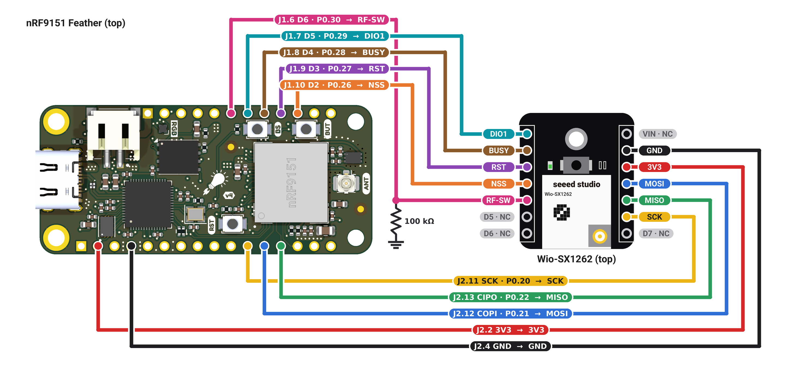

# Wio-SX1262 hookup

How to wire a Seeed Wio-SX1262 for XIAO to the nRF9151 Feather for this
gateway. The pins match
[`boards/circuitdojo_feather_nrf9151_ns.overlay`](../boards/circuitdojo_feather_nrf9151_ns.overlay).

Both boards are shown from the top. J1 is the Feather's 12-pin header (top
edge, pin 1 = VBAT); J2 is the 16-pin header (bottom edge, pin 1 = ~RST).

**Which module.** This is the version with the 30-pin board-to-board
connector on the back (from the XIAO ESP32S3 kit,
[schematic](https://files.seeedstudio.com/products/SenseCAP/Wio_SX1262/Schematic_Diagram_Wio-SX1262_for_XIAO.pdf)).
The standalone module (SKU 113010003, no back connector,
[schematic](https://files.seeedstudio.com/products/SenseCAP/Wio_SX1262/Wio-SX1262%20for%20XIAO%20V1.0_SCH.pdf))
has a different left header: D0 (button), DIO1, RST, BUSY, NSS, RF-SW. Check
which one you have before wiring.

## Connections

| Wio-SX1262 | Feather pin | nRF9151 | Overlay |
|---|---|---|---|
| 3V3   | J2.2 `3V3`   | —     | supply |
| GND   | J2.4 `GND`   | —     | ground |
| SCK   | J2.11 `SCK`  | P0.20 | `spi1` `SPIM_SCK` |
| MOSI  | J2.12 `COPI` | P0.21 | `spi1` `SPIM_MOSI` |
| MISO  | J2.13 `CIPO` | P0.22 | `spi1` `SPIM_MISO` |
| NSS   | J1.10 `D2`   | P0.26 | `cs-gpios` (active low) |
| RST   | J1.9 `D3`    | P0.27 | `reset-gpios` (active low) |
| BUSY  | J1.8 `D4`    | P0.28 | `busy-gpios` |
| DIO1  | J1.7 `D5`    | P0.29 | `dio1-gpios` |
| RF-SW | J1.6 `D6`    | P0.30 | `rx-enable-gpios`, plus 100 kΩ to GND |

Leave the Wio's **VIN**, **D5**, **D6** and **D7** unconnected. The Wio's
D5–D7 are XIAO pass-through positions with nothing on them, unrelated to the
Feather's D5–D7.

## RF switch

The module's RF switch has two controls (Seeed's block diagram): **DIO2**
for the TX side, driven by the SX1262 itself (`dio2-tx-enable`), and
**RF-SW** for the RX side, driven by the MCU: high while receiving, low
while transmitting or idle. This is how Meshtastic (through RadioLib)
drives the module, and how Zephyr's `wio_tracker_l1` board is configured
(`rx-enable-gpios` with `dio2-tx-enable`).

- RF-SW has no pull resistor on the module's board (both schematics), and
  the module's block diagram doesn't show one inside. The **100 kΩ to GND**
  keeps the RX side off while the nRF pin isn't driven: at boot, and when
  the driver disconnects its GPIOs for power management. It costs about
  33 µA while receiving.
- Zephyr's native SX126x driver ignores `rx-enable-gpios` when
  `dio2-tx-enable` is set. ret-client carries a fix in
  [`zephyr/patches.yml`](../../../zephyr/patches.yml). Update with
  `west patch clean`, `west update`, `west patch apply`; without the patch
  RF-SW is never driven and reception suffers.

## Other notes

- **Power.** The module runs from the Feather's 3V3 (J2.2), which feeds the
  module's VCC directly. Don't connect VIN: it only goes to the module's
  board-to-board connector.
- **Antenna.** Fit a LoRa antenna to the Wio's U.FL before transmitting.
  The U.FL on the Feather (ANT) is the LTE antenna.
- **TCXO.** DIO3 powers the module's TCXO at 1.8 V
  (`dio3-tcxo-voltage`), with a 5 ms start-up delay.
- **Why `uart1` is disabled.** On the nRF9151, SPIM1 and UARTE1 are the
  same peripheral instance, so `spi1` can only be used with `uart1` off.
  On the Feather, `uart1` is the modem-trace UART on J2 RX/TX
  (P0.23/P0.24), so modem traces over UART aren't available in this build.
- **Radio settings.** Defaults are 915 MHz at 14 dBm
  (`CONFIG_RET_LORA_FREQ_HZ`, `CONFIG_RET_LORA_TX_POWER_DBM` in
  [`Kconfig`](../Kconfig)). Match the frequency to your module's band
  (US915 / EU868) and your region.

## Checking it on the board

- With the radio receiving, RF-SW (J1.6) reads 3.3 V; during a transmit
  and when idle it reads 0 V.
- A packet from a nearby node is received at a sensible RSSI. Without
  RF-SW driven, expect much weaker or no reception while transmit still
  works.
